# Spruce Apartment 3D

A walkable, **to-scale** Three.js model of a one-bedroom apartment (Plan 1D, 676 sq ft), built so we could plan furniture before moving in. Every wall, door, cabinet and piece of furniture comes from the floor plan, tape-measured dimensions or product listings, and is placed to the inch. You can orbit it like a dollhouse, walk through it at eye height, open doors and cabinets, compare storage options in place, and view cabinets at real size in your room with iPhone AR.


No external 3D assets or image textures are used. Every surface (wood grain, carpet, marble, bead board, louvers) is drawn procedurally on canvas, so the repo is just code.

---

## Quick start

```bash
pnpm install
pnpm run dev          # http://localhost:5173
```

Requires Node 20+ and pnpm. A production build is a static site:

```bash
pnpm run build        # → dist/ (index.html + ar.html + public/ar/*.usdz)
```

---

## The three views

| Dollhouse (`1`) | Plan (`3`) with dimensions (`M`) | Walk (`2`) |
|---|---|---|
|  | 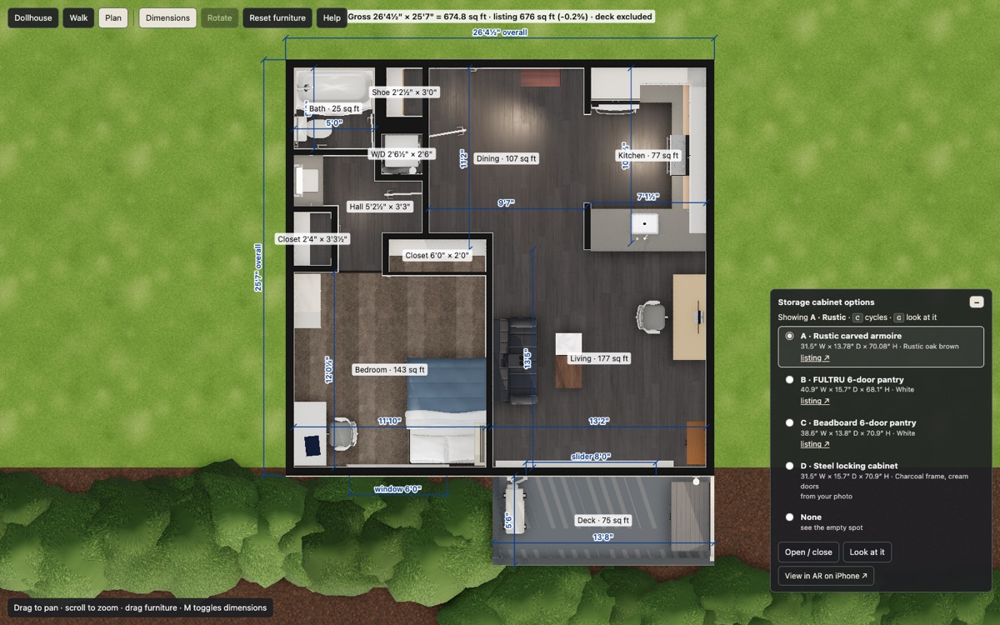 | 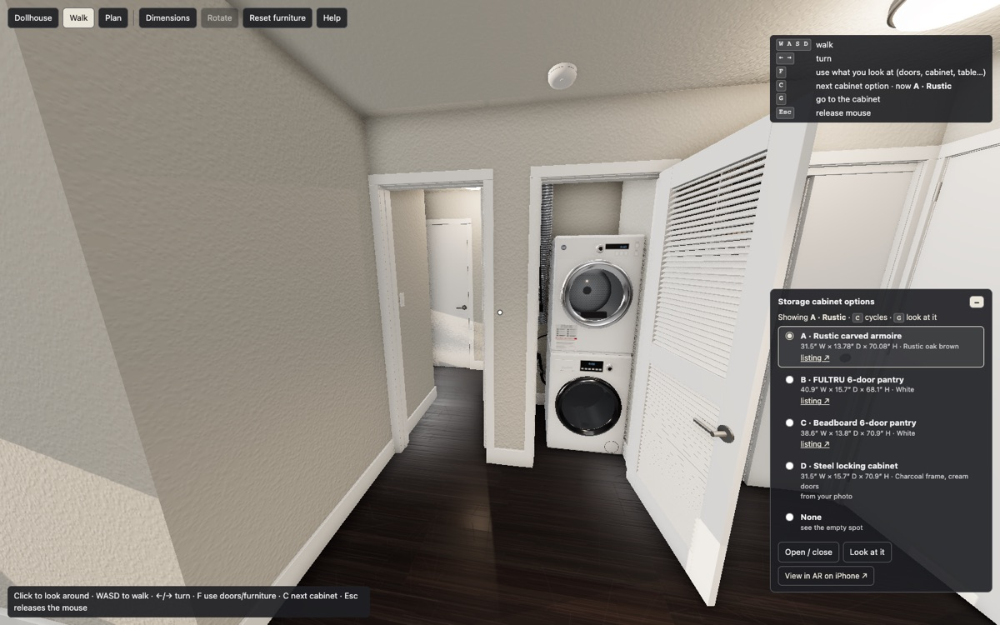 |
| Orbit and zoom. Drag furniture to move it; it stays on the floor and slides along walls. | Top-down, with room sizes, wall lengths and an area check against the 676 sq ft listing. | First person at 5'7" eye height with collisions. Aim the crosshair and press **F** to use what you're looking at. |

### Controls

| Where | Input | Does |
|---|---|---|
| Anywhere | `1` `2` `3` | Dollhouse · Walk · Plan |
| | `M` | Dimensions overlay |
| | `C` / `G` | Cycle the storage-cabinet option / look at it |
| | `H` | Help panel |
| Dollhouse / Plan | Drag | Move a piece of furniture |
| | Click | Select it, or open it (doors, coffee table, futon, wardrobe, cabinet, shed, shoe-closet doors) |
| | `N`, arrows (`Shift` = 6"), `R` | Next piece, nudge 1", rotate 90° |
| Walk | Click, then mouse | Look around (`Esc` releases) |
| | `W A S D`, `← →` / `Q E` | Walk, turn |
| | `F` | Use the thing under the crosshair; the prompt says what it will do |

**Reset furniture** puts everything back where `src/dimensions.js` says. Dragged positions are not saved.

---

## A tour

### Living room

The long desk and monitor sit on the gray accent wall, the futon and lift-top coffee table face the slider, and the cabinet slot is in the corner by the balcony.

| | |
|---|---|
|  | 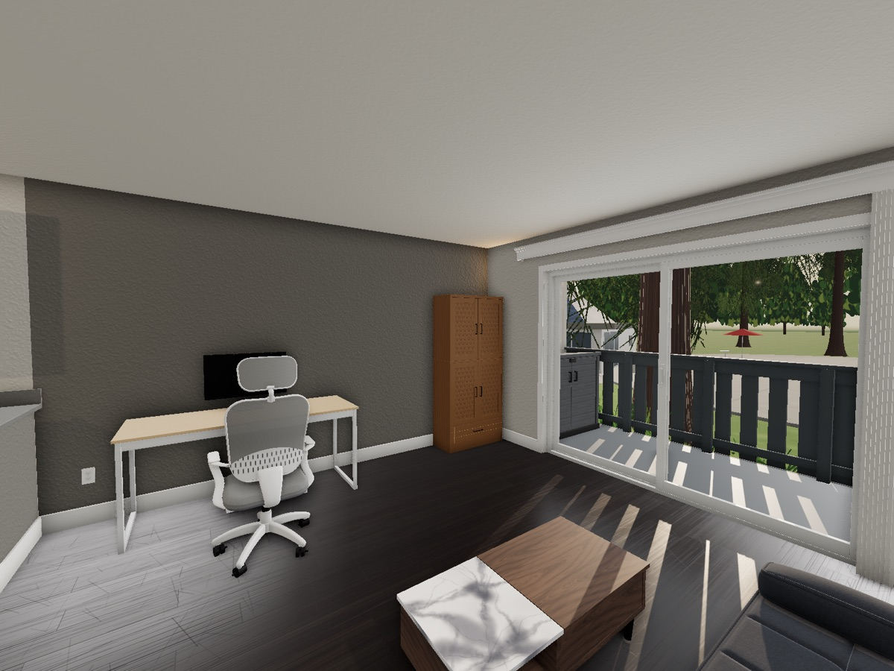 |
|  |  |
| 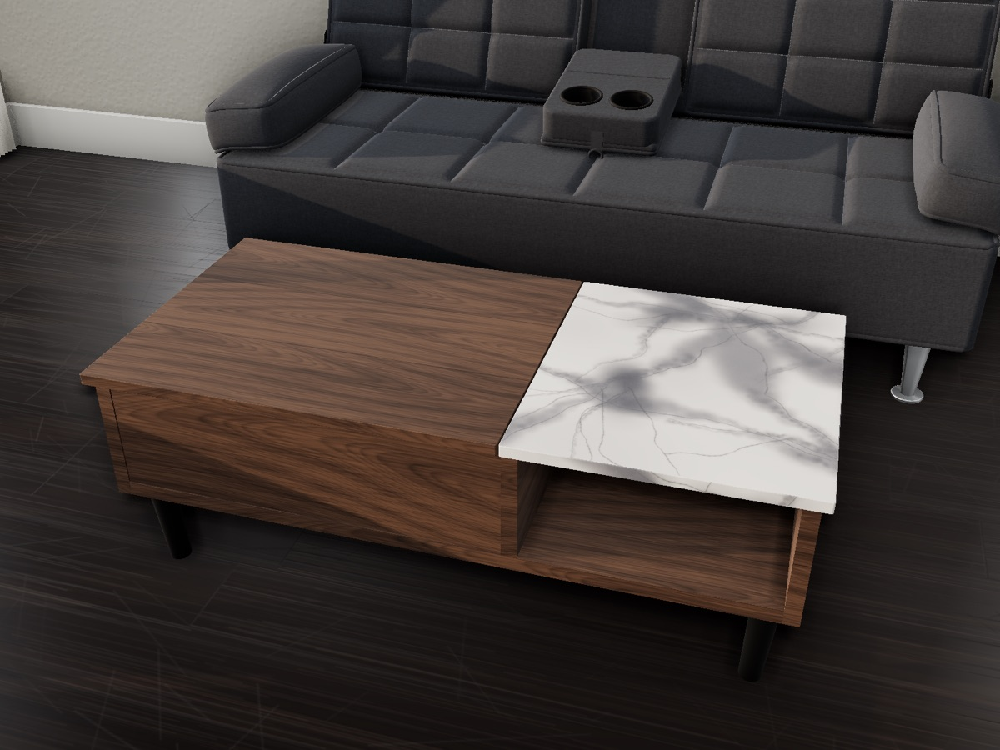 | 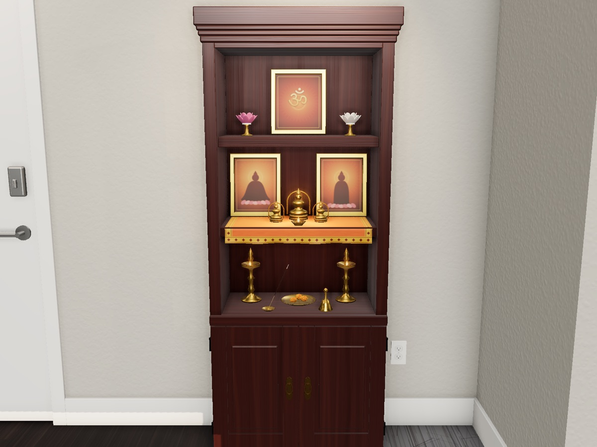 |

The coffee table's top lifts and the futon folds into a bed (click or press `F`). The bookcase near the entry is set up as a home mandir.

### Bedroom

Full bed on the north wall, a three-door wardrobe beside it, and a second desk and chair by the window.

| | |
|---|---|
|  |  |
|  | 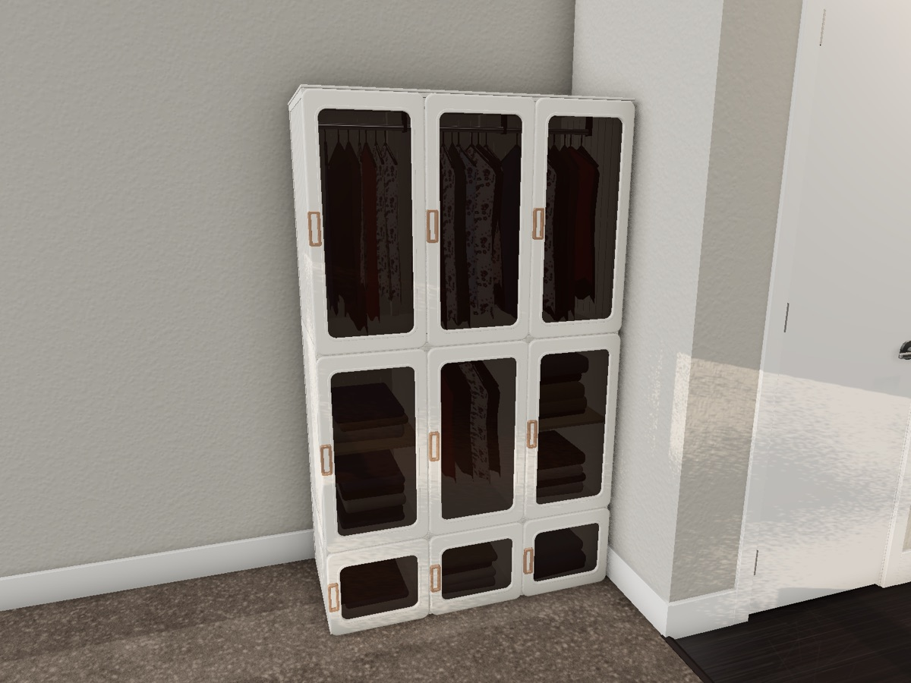 |
|  | |

### Kitchen, bath and deck

| | |
|---|---|
| 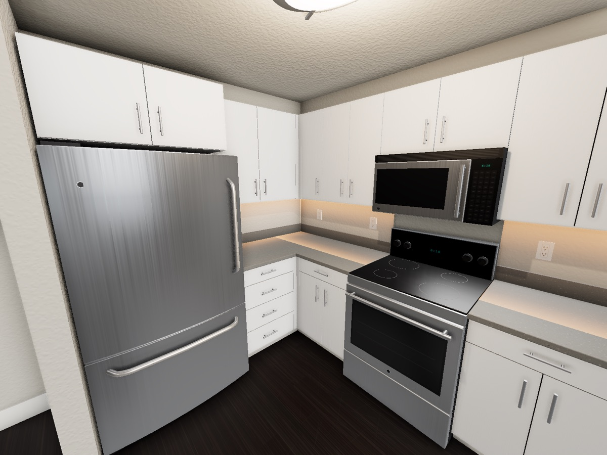 | 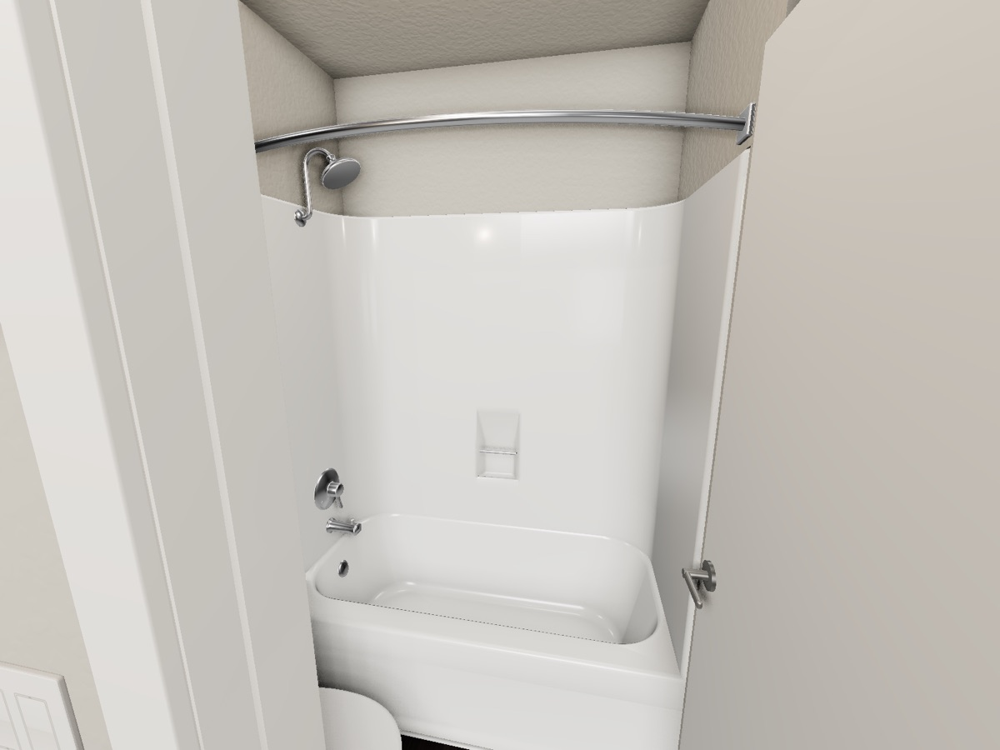 |
| 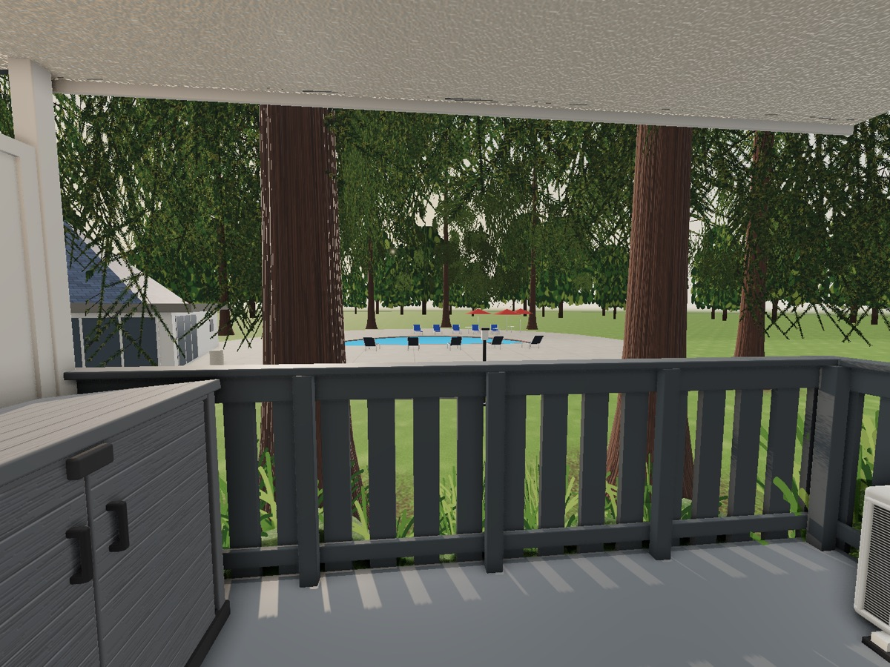 | 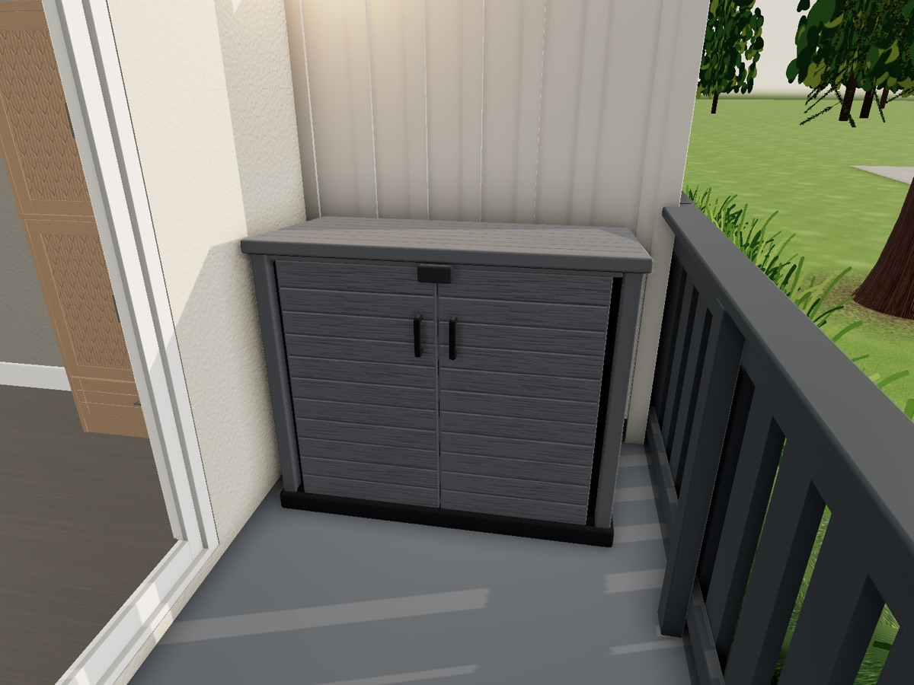 |

The resin storage shed (51.2 × 29.1 × 43.3") stands at the end of the deck. Its doors and lid open.

### Shoe closet

The entry closet (36" W × 26.5" D) holds a 9-tier shoe rack under the existing rod and shelf. Its bypass doors slide left or right. Clicking the rack toggles it between 9 and 10 tiers: at 10 tiers it would hit the rod, which shows as a red clash marker.

| Left door open | Cutaway: rack under the rod |
|---|---|
| 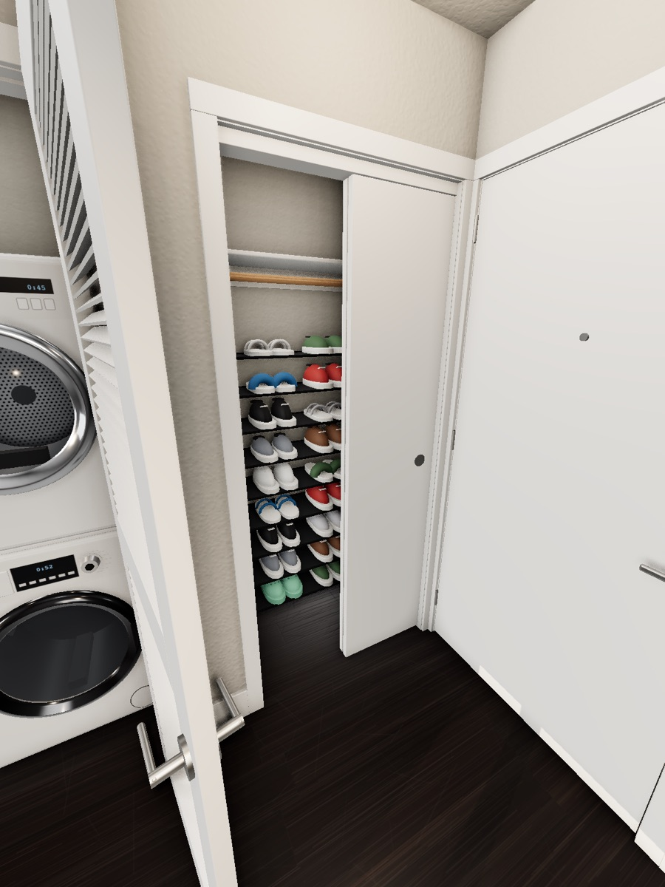 | 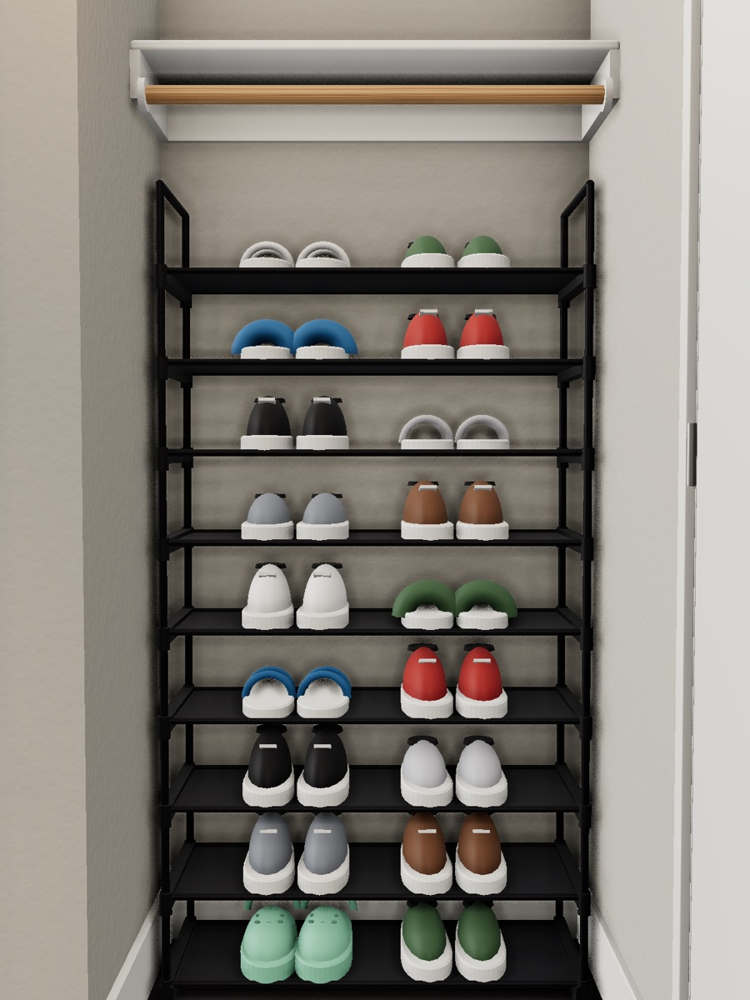 |

---

## Storage cabinet options

Four candidate cabinets share one slot by the slider. Switch between them with the panel at the bottom right, the `C` key, or `?cabinet=1..4` in the URL. Click a cabinet (or press `F` in Walk) to open its doors.

| A · Rustic 31.5 × 13.8 × 70.1" | B · Pantry 40.9 × 15.7 × 68.1" | C · Bead board 38.6 × 13.8 × 70.9" | D · Steel locker 31.5 × 15.7 × 70.9" |
|---|---|---|---|
|  |  | 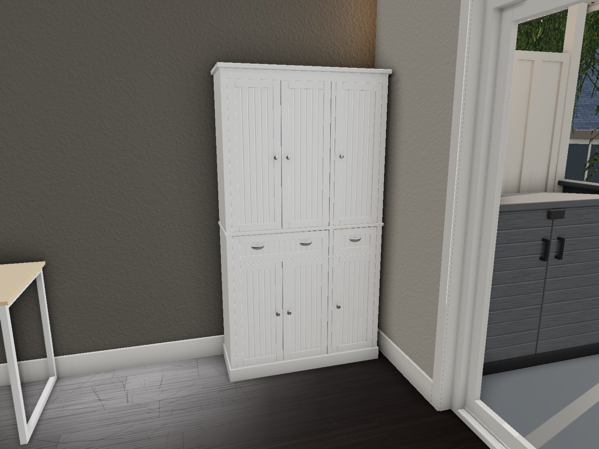 | 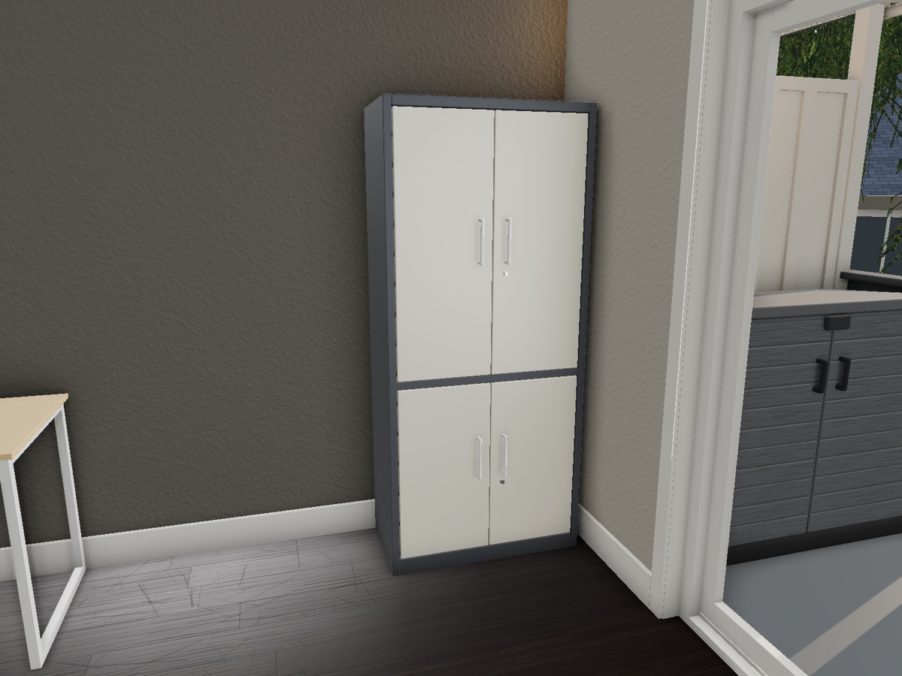 |

### See them in your own room (iPhone AR)

`ar.html` lists each cabinet plus an "all four side by side" model as USDZ files. Tapping one on an iPhone opens **AR Quick Look**: the camera finds your floor and places the cabinet at true size, with scaling locked so it can't be resized by accident.

- From the deployed site, open `/ar.html` in Safari on the iPhone. AR Quick Look needs HTTPS or a local network address.
- Locally, run `pnpm run dev:phone` on the same Wi‑Fi and open `http://<mac-ip>:5183/ar.html`.
- After changing a cabinet model, run `pnpm run export:ar` to regenerate `public/ar/*.usdz`. The export re-imports each file and checks its size.

---

## How it's built

```
src/
  dimensions.js      single source of truth: every size and position, in inches
  apartment.js       assembles shell + rooms + furniture
  shell.js           walls, floors, ceilings (from WALLS / ROOMS)
  rooms/             finishes, openings (doors, sliders), kitchen, bath, closets, deck, lighting
  furniture/         one module per piece; cabinet.js is the A–D option slot, cabinets/* the models
  lib/               build helpers, procedural wood grain + normal maps
  main.js            viewer: modes, controls, HUD, cabinet panel, shots
  shots.js           named camera poses used for screenshots
ar.html              iPhone AR Quick Look page
tools/               screenshot, test and AR-export scripts (Playwright)
docs/                spec, photo index, assumptions log, screenshots
```

**Coordinates.** Plans use inches, with x running toward the kitchen side and y toward the deck. `m()` converts to metres once, at the point of building. Each furniture module returns a group whose origin is at the bottom centre with its front facing +Z. `apartment.js` then places it from `FURNITURE.<piece>.pos` and `rot`.

**Interactivity** is driven by `userData` hooks on objects: `onClick`, `tick`, `actionLabel`, `setOpen`/`animate`. The viewer handles clicks in Dollhouse and the `F` key in Walk the same way.

**Lighting** is set for early evening: a low sun through the slider and the bedroom window, every real fixture switched on, rect-area sky light from the glazing, and GTAO ambient occlusion.

### Changing things

- Resize or move furniture by editing `FURNITURE.<piece>` in `src/dimensions.js` (`w`, `d`, `h`, `pos: [x, y]`, `rot`).
- Swap the cabinet candidates by editing `CABINETS.rustic | pantry | beadboard | steel`. `CABINETS.anchor` is the slot position.
- The building itself is described by `ENV`, `WALLS`, `ROOMS` and `DOORS`. Set `toggle` on a door to make it clickable.

Anything that wasn't measured or photographed is recorded in [`docs/assumptions.md`](docs/assumptions.md), with one line per assumption. Measurements are in [`docs/spec.md`](docs/spec.md).

---

## Tools and tests

```bash
node tools/shot.mjs living desk 'cabinet&cabinet=2'   # → shots/*.png, deterministic camera poses from src/shots.js
node tools/shot.mjs --view=plan --dims               # plan view with dimensions
node tools/shot.mjs --eval="__apt.bounds('desk')"    # measure anything in the scene (inches)
node tools/interact-test.mjs                          # doors, F key, cabinet switching
node tools/walk-test.mjs                              # walk collisions + turning
node tools/drag-test.mjs                              # drag, rotate, reset
```

Each tool starts its own Vite server and drives headless Chrome through Playwright.

## Deployment

`pnpm run build` produces a fully static `dist/`. Any static host works. The deployed copy is served by Caddy, which provides HTTPS. Serve `.usdz` files as `model/vnd.usdz+zip`; the dev server already does this in `vite.config.js`.

## Notes

- The reference photos used to build the model (the apartment and the product listings) are kept out of this public repo. Comments that mention `refs/` or `spruce_apt_photos/` refer to those local files.
- Built by Sreenivasan AC with Claude Code.
